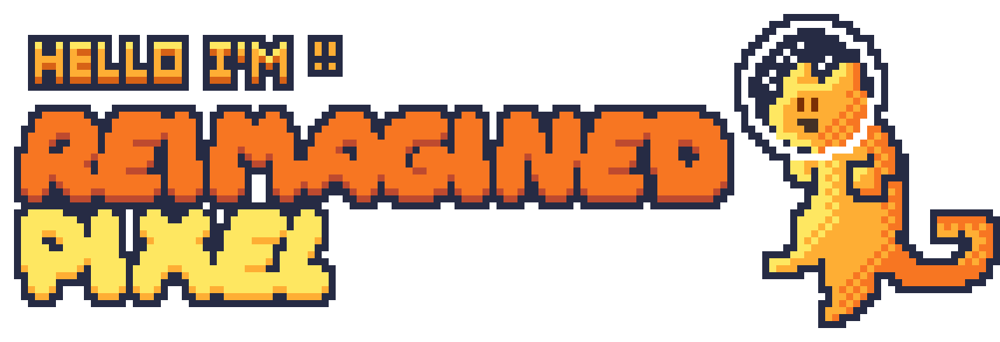
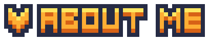
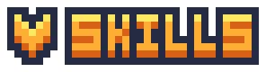
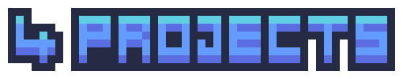
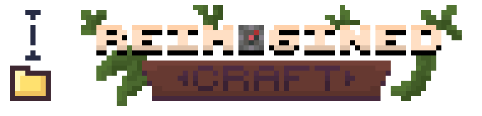
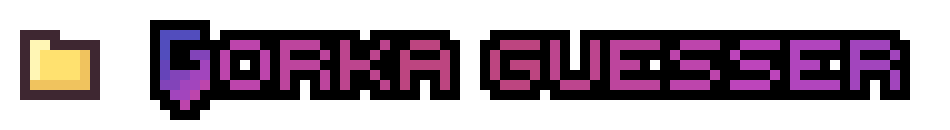
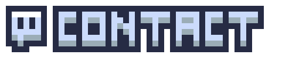

  

  Solo dev from Poland · Minecraft servers, plugins, models and the content around them

<table>
<tr>
<td valign="top" width="50%">

 

### I'm a solo dev from Poland.
I've been making Minecraft servers for <ins>over 7 years</ins>.\
Started modding Minecraft before I knew what Java was :D\
Most of my projects live and die on my own machine first. :/\
I go by **ReimaginedPixel** online.\
I attend a technical high school in Poland. 🏫\
I build things I'd actually want to play myself.\
I've been editing videos almost as long as I've been coding.\
I make content about the things I build.

</td>
<td valign="top" width="50%">

 

I write Java plugins for Minecraft. Been at it for 6+ years.\
I know HTML and CSS well enough to build something with them.\
I've been doing pixel art and texturing for about 2 years.\
I model in Blockbench. I've made custom weapons, items, and mobs.\
I can edit video. I've been doing it for years, not days.\
I write PHP for backend stuff. Nothing fancy, just what works.\
C++ for a couple of years, mostly school and small tools.\
I use SQLite and MySQL depending on the project.

</td>
</tr>
</table>

<table>
<tr>
<td valign="top" width="50%">

 

[ReimaginedCraft](https://www.reimaginedcraft.net) is a medieval fantasy Minecraft survival server I've been building solo for over two years.\
I'm not copying an existing server. I'm building something I'd actually want to play.

Read more

Every major system is a **custom plugin I wrote myself.**\
Your tools are gated behind skill levels. You can't use a better pickaxe until you've earned the mining level for it.\
I use ItemsAdder, MythicMobs, AuraSkills, and a dozen other plugins alongside my own.

</td>
<td valign="top" width="50%">

 

[Freaky SMP](https://reimaginedpixel.github.io/FreakySmpWebsite) started because I switched schools and wanted a way to get to know my new classmates.\
I set up a Minecraft server. People joined. It worked.

Read more

At its peak it had 30+ players. Over time it attracted cheaters and it became kind of a meme to try and nuke it.\
That chaos is honestly part of what made it memorable.\
Multiple seasons ran. Each one had its own story.\
It wasn't a serious project. It was a community that formed around a server I made.

</td>
</tr>
<tr>
<td valign="top" width="50%">

 

PROTOCOL:ENDFALL is a standalone permadeath Minecraft experience.\
You get **one life.** If you die, you can **never play again.**

Read more

The launcher is part of the game. There's no separation between the two.\
When you launch it, Minecraft starts automatically. No title screen, no pause menu, no GUI.\
When you die, the game closes. The launcher shows a final screen. It never opens Minecraft again.

*Website coming soon.*

</td>
<td valign="top" width="50%">

 

[GórkaGuesser](https://gorkaguesser.pl) is a GeoGuessr-style web game I built for my school.\
You get dropped into a 360° panorama somewhere on school grounds and have to guess where you are on a floor plan map.

Read more

Built with Next.js 15, Tailwind, Prisma, and Zustand.\
Score validation happens server-side.\
It started as a joke project. It became a real one.

</td>
</tr>
<tr>
<td valign="top" width="50%">

 

[GorkaAPI](https://gorkaapi.pl/) is one school account for apps built by students.\
Verify your school email once, then sign in to connected apps with one click.

Read more

Built around OAuth 2.0 and OpenID Connect, with PKCE required.\
Students choose what each app can access and can revoke that access whenever they want.\
Developers can connect their apps without building another registration form or password database.\
Open source, free, and run by students.

[Website](https://gorkaapi.pl/) · [Documentation](https://gorkaapi.pl/docs)

</td>
<td valign="top" width="50%">

 

Two extensions I built for Fiverr: [Dark Mode](https://github.com/ReimaginedPixel/fiverr-dark-mode) and [Inbox Tags](https://github.com/ReimaginedPixel/fiverr-inbox-tags).\
A dark theme for the whole site, plus status tags and client tools to keep the inbox organized.

Read more

**Dark Mode** converts Fiverr's styles into a dark theme while keeping its brand colors, images and videos intact. One click toggles it.\
**Inbox Tags** adds custom statuses, reply flags, AI client summaries, deal scores, chat copying and exports for Claude Code.\
They work separately, and Inbox Tags matches the dark theme when both are installed. AI features use your own OpenAI API key.

[Dark Mode](https://github.com/ReimaginedPixel/fiverr-dark-mode) · [Inbox Tags](https://github.com/ReimaginedPixel/fiverr-inbox-tags)

</td>
</tr>
</table>

---

> [!NOTE]
>  
> Need a plugin, a model or a texture made? Fiverr is the fastest way to reach me. 
> 
> 
> 
> 
